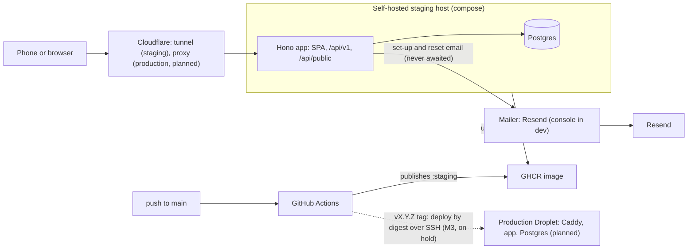
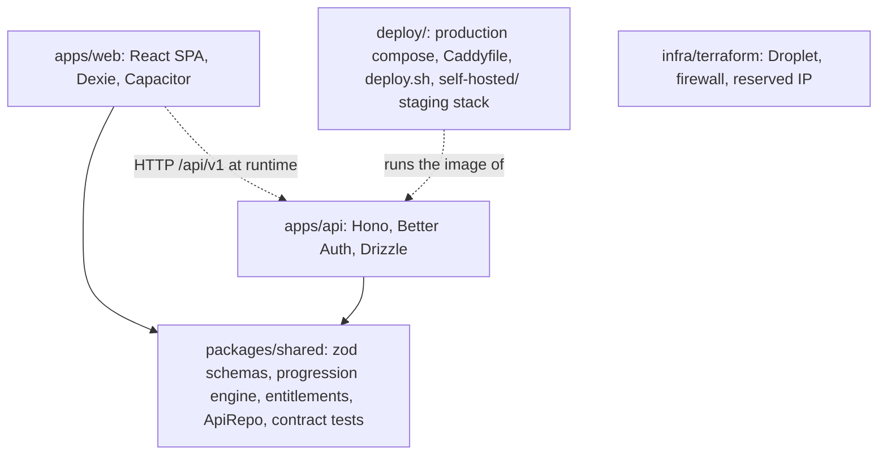
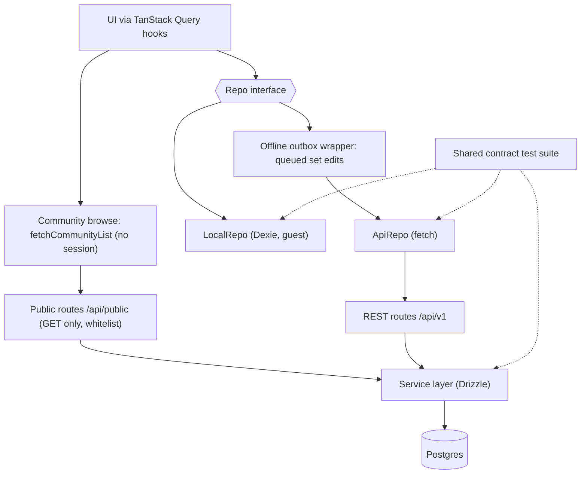
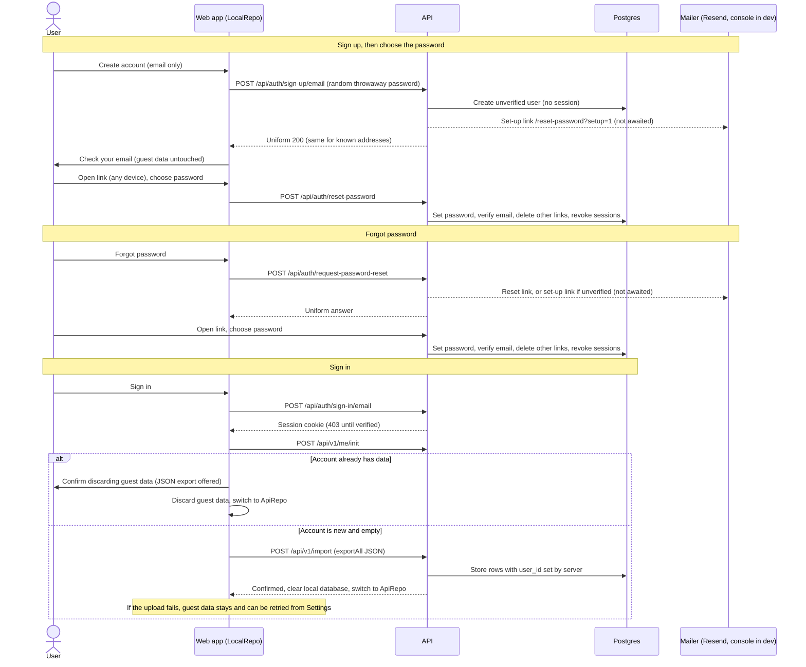

# Architecture

Diagrams of what exists today, with parts that are not built yet marked "planned" (production and Cloudflare's proxy). The spec ([spec.md](spec.md) §4, §7, §9, §11) is the source of truth.

## 1. System context

Staging runs on a self-hosted Docker host behind an existing Cloudflare Tunnel (app and Postgres only, the app port published on `127.0.0.1` only, pulled by `update.sh`). Production is planned for one Droplet running Caddy, the app and Postgres (M3, on hold). Both run the same image: Hono serving the SPA, `/api/v1` (session required) and the public community area `/api/public/*` (GET only, no session). Set-up and reset email goes out through Resend (built); production and staging refuse to start without its settings, and in development the console mailer prints links to the API log instead.

## 2. Repo layout and dependencies

The pnpm monorepo has two apps that both depend on `packages/shared`, and the web app never imports the API.

## 3. The Repo contract

The UI only talks to the `Repo` interface, which has a local guest implementation and an API implementation, and one contract test suite runs against all three layers.

## 4. Sign-up, set-up link, sign-in and guest data upload

Sign-up takes the email only, creates no session and uploads nothing: the password is chosen through the mailed set-up link, which confirms the address, and guest data stays on the device until the first successful sign-in. A new account is imported once and the local database is cleared only after the server confirms; an account that already has data replaces the guest data after confirmation. The same screens handle "forgot password"; a reset (or the set-up link mailed for an unverified account) verifies the address and revokes every session.

