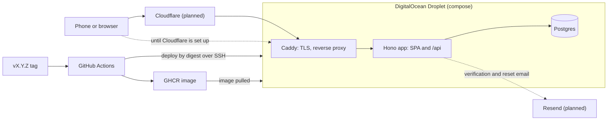
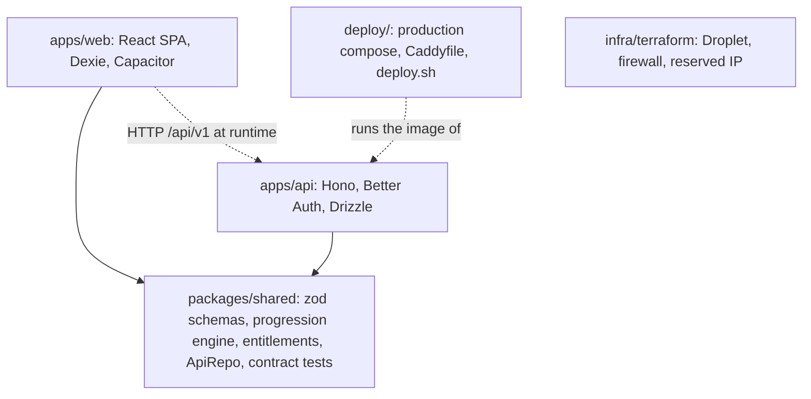
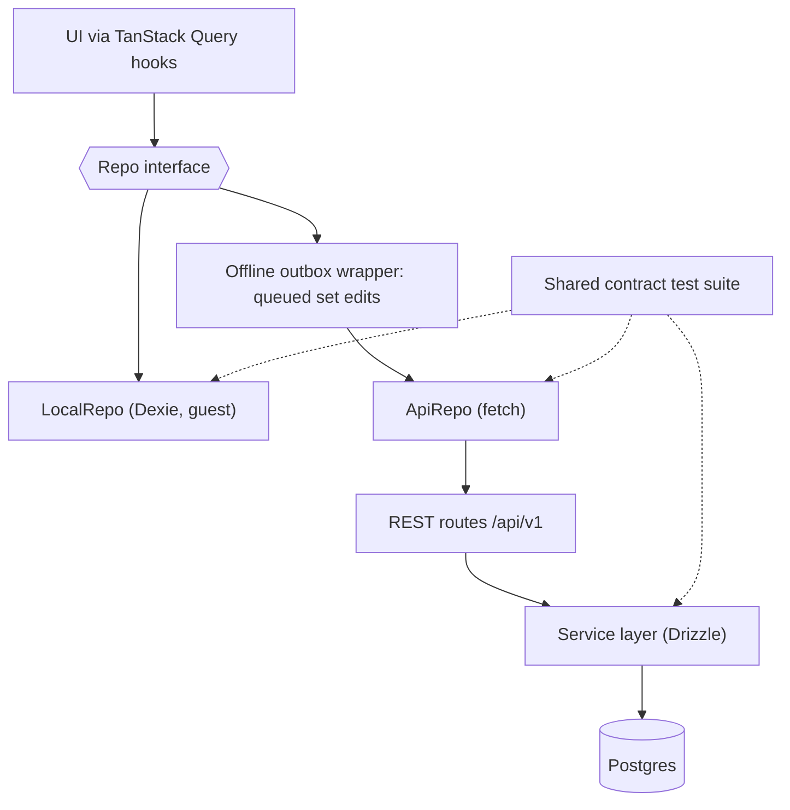
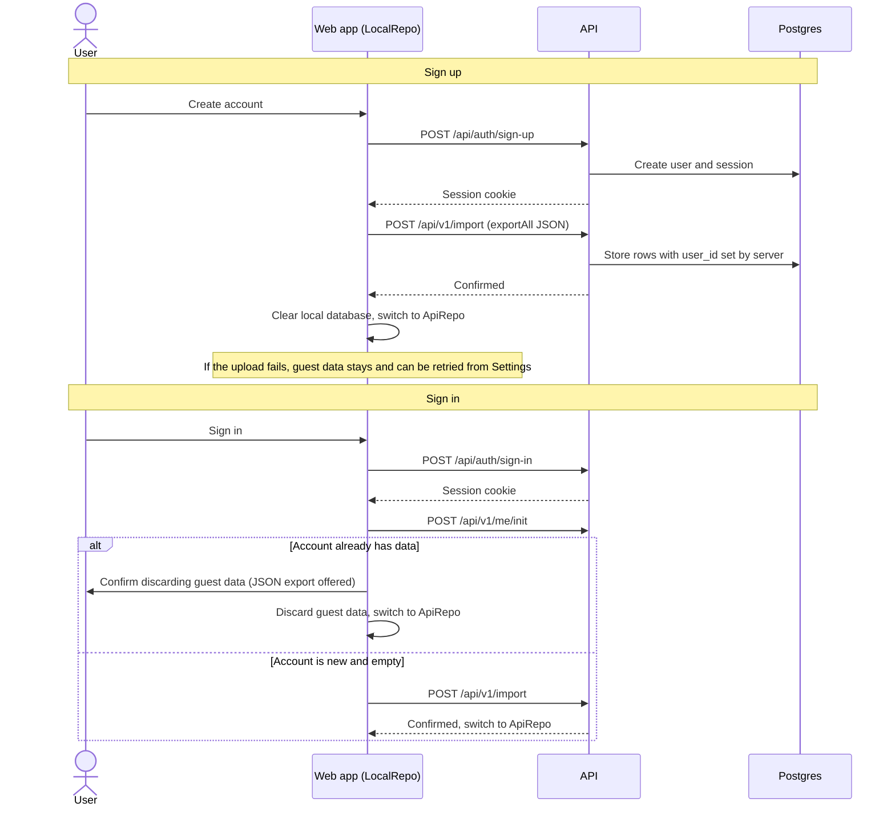

# Architecture

Diagrams of what exists today, with parts that are not built yet marked "planned". The spec ([spec.md](spec.md) §4, §7, §9, §11) is the source of truth.

## 1. System context

One Droplet runs Caddy, the app container (Hono serving the SPA and `/api`) and Postgres; images are built and deployed from GitHub Actions, and Cloudflare and Resend are planned for M3/M2b.

## 2. Repo layout and dependencies

The pnpm monorepo has two apps that both depend on `packages/shared`, and the web app never imports the API.

## 3. The Repo contract

The UI only talks to the `Repo` interface, which has a local guest implementation and an API implementation, and one contract test suite runs against all three layers.

## 4. Sign-up, sign-in and guest data upload

On sign-up the guest data is uploaded once and the local database is cleared only after the server confirms; on sign-in an account that already has data replaces the guest data after confirmation.

